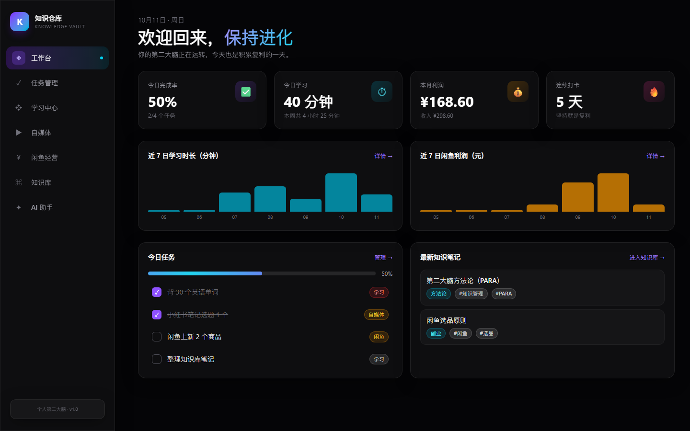
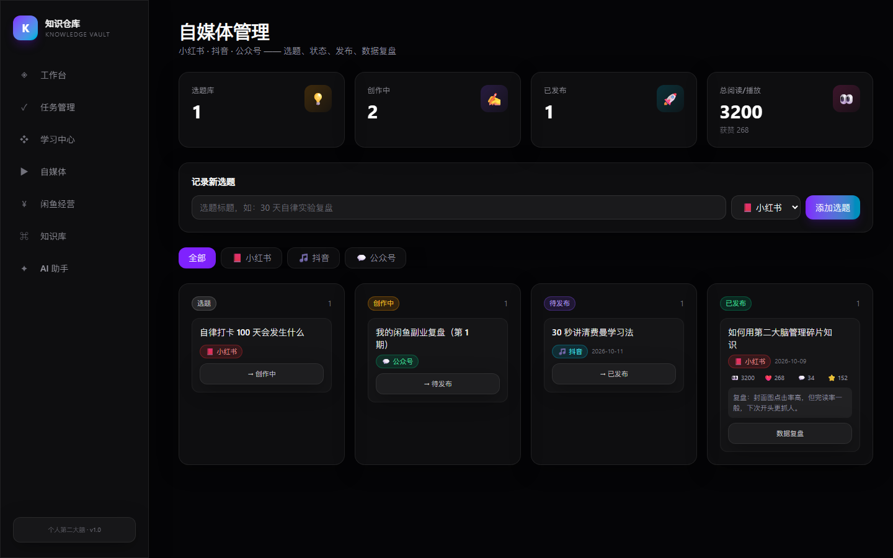
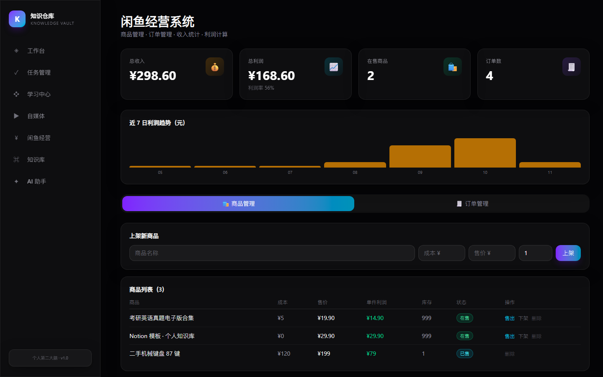
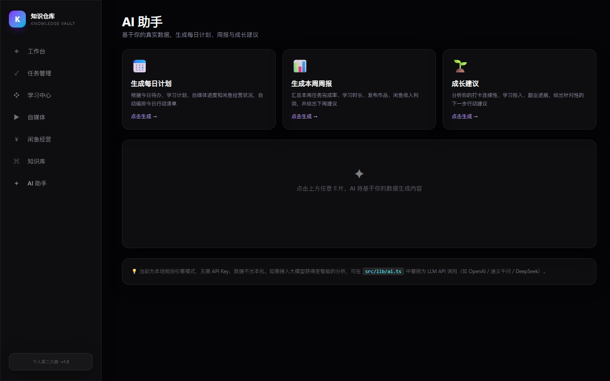
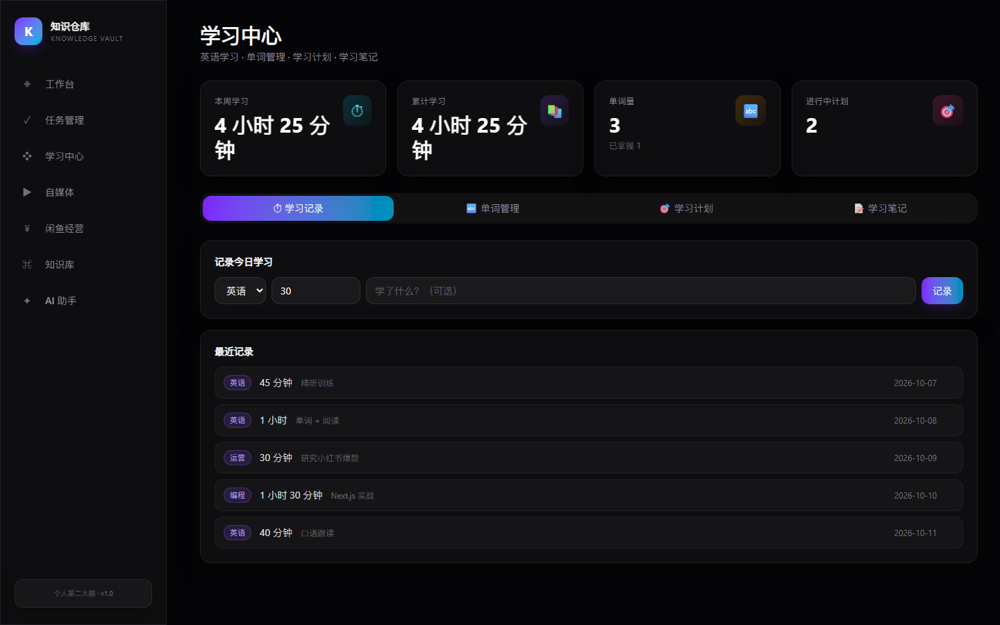
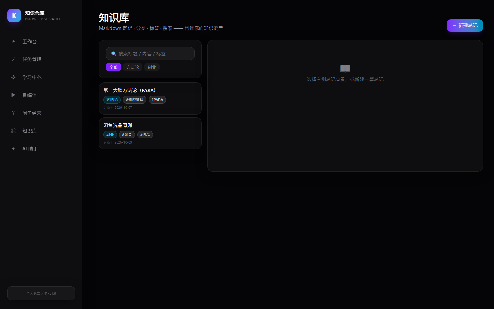
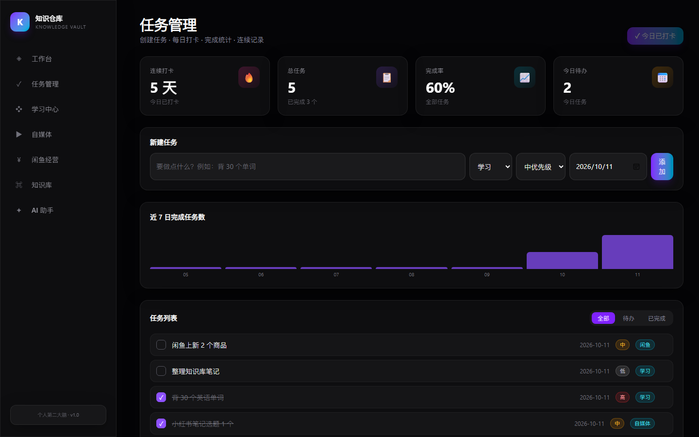

# 知识仓库 Knowledge Vault

> **一个本地优先的个人工作台：把自媒体运营、副业收入和自我管理收进同一块屏幕。**

[](https://9de3e487b16c476b80a35558b96766f6.app.codebuddy.work/)
[](https://nextjs.org/)
[](https://react.dev/)
[](https://tailwindcss.com/)
[](./LICENSE)

无需注册 · 无需服务器 · 数据不出本机



---

## 为什么做这个

做内容的人都遇到过同一组问题：

- 选题躺在备忘录里，越攒越多，最后忘了当初为什么想写
- 同时推进三个平台，进度全记在脑子里，一忙就乱
- 发布后的数据散在各平台后台，想复盘时凑不齐
- 而学习和副业的账，又是另外一摊

**Knowledge Vault 把这条线收进一处：选题 → 创作 → 发布 → 数据复盘。**

所有数据默认存在你自己的浏览器里。不注册、不上传、断网也能用。

---

## 界面

### 自媒体管理

选题看板（选题 / 创作中 / 待发布 / 已发布）+ 平台标签 + 发布后数据复盘。



### 闲鱼经营

商品、订单、收入与利润，把副业的账算清楚。



### AI 助手

基于你自己的真实数据，生成每日计划、周报和成长建议。默认走本地规则引擎，**不需要 API Key，数据不出本机**；想更聪明可以换成任意 LLM。



<details>
<summary>展开查看其余界面（学习中心 / 知识库 / 任务管理）</summary>

**学习中心** —— 学习记录、单词管理、计划与笔记



**知识库** —— Markdown 笔记、分类、标签、全文搜索



**任务管理** —— 每日打卡、完成统计、连续记录



</details>

---

## 快速开始

### 方式一：直接在线用（最省事）

打开 [在线体验](https://9de3e487b16c476b80a35558b96766f6.app.codebuddy.work/)，点开就能用，数据存在你自己的浏览器里。

### 方式二：本地运行

```bash
npm install
npm run dev
```

打开 http://localhost:3000

> 环境要求：Node.js 20 及以上。

### 方式三：部署成自己的

项目使用静态导出（`next.config.ts` 里 `output: "export"`），所以 `npm run build` 之后
产物是一堆纯静态文件，**不需要 Node 服务器**：

```bash
npm run build
```

把 `out/` 目录直接丢到 GitHub Pages、Cloudflare Pages、Vercel 或任意静态托管都能跑。

---

## 功能

| 页面 | 路径 | 说明 |
|---|---|---|
| 工作台 | `/` | 今日完成率、学习时长、副业收入、连续打卡、7 日趋势 |
| 任务管理 | `/tasks` | 创建任务、每日打卡、完成统计、连续记录 |
| 学习中心 | `/learning` | 学习记录、单词管理、学习计划、学习笔记 |
| 自媒体管理 | `/media` | 小红书 / 抖音 / 公众号：选题看板、状态流转、发布时间、数据复盘 |
| 闲鱼经营 | `/xianyu` | 商品管理、订单管理、收入统计、利润计算 |
| 知识库 | `/knowledge` | Markdown 笔记、分类、标签、全文搜索 |
| AI 助手 | `/ai` | 基于个人数据生成每日计划、周报、成长建议 |

响应式布局：PC 上是侧边栏，手机上是底部导航，同一套代码。

---

## 数据存在哪

默认使用浏览器 **localStorage**，数据完全在你自己设备上，开箱即用。

如果你想要跨设备同步，可以接入 Supabase（可选）：

1. 在 [supabase.com](https://supabase.com) 创建项目
2. 在 SQL Editor 中执行 `supabase/schema.sql` 建表
3. 复制 `.env.local.example` 为 `.env.local`，填入项目 URL 和 anon key

数据层在 `src/lib/store.ts`，当前是 localStorage 实现，可以在此基础上扩展云端同步。

想让 AI 助手更聪明的话，`.env.local` 里支持 `DEEPSEEK_API_KEY` 或 `OPENAI_API_KEY`，
也可以直接在界面上配置。

---

## 技术栈

- **Next.js 16**（App Router，静态导出）
- **React 19** + **TypeScript 5**
- **Tailwind CSS 4** —— 深色玻璃拟态界面
- **Recharts** —— 趋势图表
- **Supabase**（可选）—— 云端同步
- **PWA** —— 支持添加到主屏幕

## 目录结构

```
src/
├── app/              # 页面（工作台/任务/学习/自媒体/闲鱼/知识库/AI）
├── components/       # Sidebar、玻璃拟态 UI 组件、PWA、Toast
└── lib/
    ├── types.ts      # 数据类型（与 schema.sql 对应）
    ├── store.ts      # 本地优先数据层
    ├── seed.ts       # 首次运行的示例数据
    ├── ai.ts         # 计划 / 周报 / 建议生成引擎
    ├── markdown.tsx  # 极简 Markdown 渲染器
    └── supabase.ts   # Supabase 客户端（可选）
supabase/schema.sql   # 数据库表结构
screenshots/          # README 用的界面截图
```

---

## 许可证

[MIT](./LICENSE)

---

> 如果你也在同时做内容和副业，欢迎提 Issue 说说你缺什么。
> 这个项目最初只是为了解决我自己的问题，能被别人用上算是意外收获。
